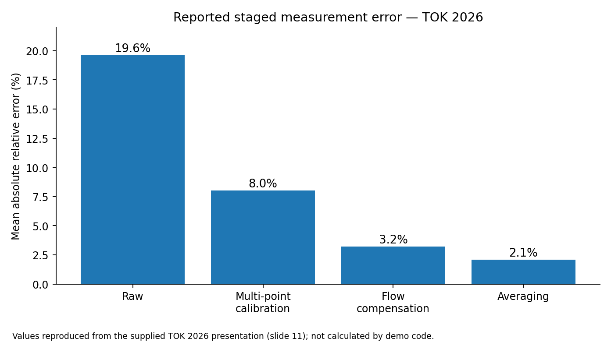
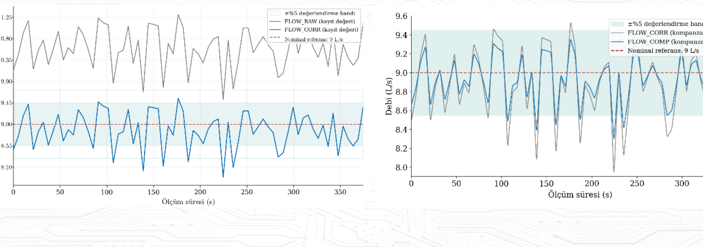
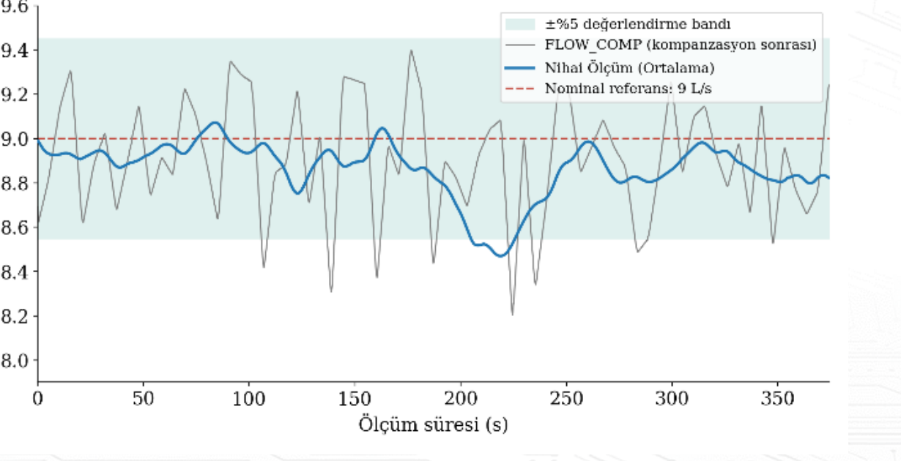

# Ultrasonic Flow Measurement & Signal Processing

**Multi-point calibration · Flow compensation · Averaging · Embedded C**

An independent, hardware-agnostic demonstration of the signal-processing stages used in ultrasonic flow measurement. The code is an **illustrative implementation**, not a production device firmware release.

## 1. Measurement principle

A transit-time flowmeter compares ultrasonic propagation times in opposite directions. A flow estimate is derived from the time difference and the measurement geometry. The measurement signal may contain systematic bias and transient fluctuations, making correction and averaging important.

## 2. Core signal processing architecture

```text
Upstream / downstream transit-time measurements
                   |
             Raw flow estimate
                   |
          Multi-point calibration
                   |
            Flow compensation
                   |
               Averaging
                   |
         Stabilized flow estimate
```

This is a **conceptual processing model** from the TOK 2026 presentation, not a claim that the accompanying demonstration source code is identical to the implementation discussed in the presentation.

### Multi-point calibration

Different flow regions can exhibit different systematic measurement errors. Instead of one global gain, the calibration stage uses multiple reference points and interpolates a flow-dependent correction factor:

`Q_calibrated = Q_raw × K(Q_raw)`

Linear interpolation between adjacent calibration coefficients provides a continuous correction curve. The example C code uses **synthetic** calibration points.

### Flow compensation

The academic presentation identifies an additional flow compensation stage for reducing residual, operating-region-dependent errors **after calibration**. Its implementation formula and coefficients are not included in the provided source material.

For reproducibility, the example C code uses a **separately defined, synthetic piecewise-linear residual correction**:

`Q_compensated = Q_calibrated + R(Q_calibrated)`

`R` is only an example model; it is **not** a reverse-engineered or verified production compensation algorithm.

### Measurement averaging

Averaging reduces short-term fluctuations at the cost of response delay. The provided presentation discusses a measurement window of **50 samples at a nominal 100 ms interval (5-second target window)**. Actual timing may vary with execution time.

The independent demo implements configurable moving-window arithmetic averaging followed by an EMA; it does not reproduce the complete original pipeline.

### Supporting quality controls

Production measurement-processing designs may also use status checks, median filters, outlier rejection, rate limiting, and temporary last-valid-value retention. These are described as design considerations and are **not claimed to be implemented** in the accompanying minimal C demo.

## 3. Engineering results presented at TOK 2026

The supplied presentation reports the following staged mean absolute relative error values. These are **reported academic presentation results**, not benchmarks produced by this repository's C example.



| Reported stage | Mean absolute relative error |
|---|---:|
| Raw estimate | 19.6% |
| Multi-point calibration | 8.0% |
| Flow compensation | 3.2% |
| Averaging | 2.1% |

The slides also report **94.3% of samples within a ±5% band** (presentation slide 11).

### Original presentation graph excerpts (review before publishing)

The following plot excerpts were cropped from the user-supplied conference presentation, **not regenerated from raw data**. Their underlying time-series samples were not provided. Confirm publication rights before pushing them to a public repository.

**Calibration and compensation (slide 9)**



**Averaging and temporal response (slide 10)**



## 4. Minimal repository layout

```text
ultrasonic-flow-signal-processing/
├── README.md
├── ultrasonic.c
├── ultrasonic.h
└── figures/
    ├── reported_error_stages.png
    ├── calibration_and_compensation_source.png
    └── averaging_source.png
```

## 5. Run the C demonstration

Use GCC or Clang. This is plain C, with no STM32 HAL or third-party dependencies.

```bash
gcc -std=c11 -Wall -Wextra -Werror -DULTRASONIC_DEMO ultrasonic.c -lm -o ultrasonic_demo
./ultrasonic_demo
```

The program prints synthetic sample flow values at each stage. The published research metrics above should **not** be attributed to its output.

## 6. Scope and attribution

- Academic results and two graph excerpts: *LoRaWAN Tabanlı Siber-Fiziksel Akış Ölçüm ve Uzaktan Yapılandırma Sisteminin Tasarımı ve Gerçekleştirilmesi*, TOK 2026 conference presentation, O. İ. Yavuz, A. T. Doğmuş, H. Soy; supplied slides 8–11.
- Independent demonstration code: written from general calibration, compensation and averaging principles with synthetic parameters.
- No company firmware, device drivers, real calibration tables or confidential measurement logs are included.
- **Publication check:** Confirm permission from the relevant rights holders before publishing original presentation graphics or reported organization-owned results. Remove the two `*_source.png` images and their Markdown references if permission is not available.
